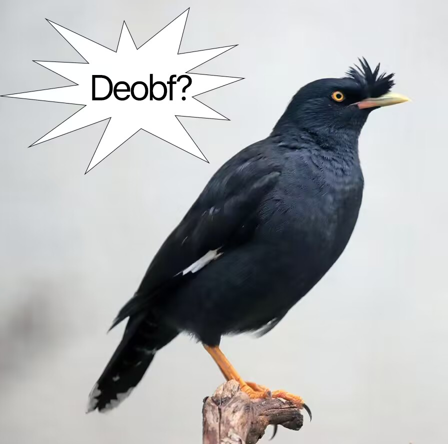

<p align="center">
  
  <br><br>
  <a href="https://discord.gg/skidsolutions">
    
  </a>
  
  
  
</p>

<p align="center">
  <a href="https://discord.gg/skidsolutions">https://discord.gg/skidsolutions by BynBang</a>
</p>

<p align="center">
  
</p>

<p align="center">
  
  
  
  
</p>

<p align="center">
  
</p>

## How to build

### Prerequisites
- **Java Development Kit**: JDK 17 (the Gradle wrapper 8.14.3 does not run on newer JDKs)

### Building OpenJNIC

Run from this folder:

```powershell
$env:JAVA_HOME = "C:\Program Files\Java\jdk-17"

.\gradlew.bat clean build
```

Generated `build/libs/`:
- `OpenJNIC-3.7.0.jar`
- `OpenJNIC-3.7.0-sources.jar`

### Running

```powershell
java -jar build\libs\OpenJNIC-3.7.0.jar <inputJAR> <outputJAR> <configFile> [-debug]
```
